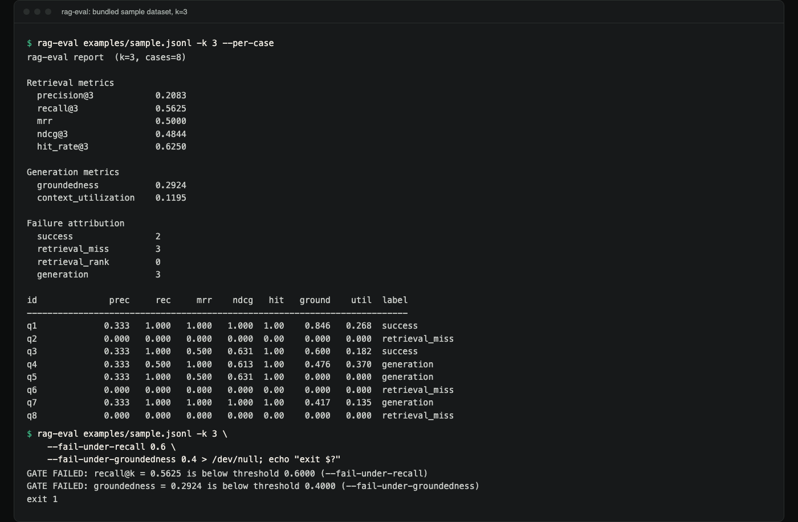

# rag-eval

Offline evaluation for retrieval-augmented generation (RAG) pipelines.
`rag-eval` scores retrieval quality and answer groundedness separately, and
tells you *which stage failed* when a case goes wrong. No API keys, no
model calls, no network access.

**Status:** version 0.1.0, not on PyPI. Standard library only. CI runs the
tests on Linux, macOS and Windows with Python 3.10 to 3.13. Groundedness is
a lexical proxy, not a fact check (see [Limitations](#limitations)).

## Demo



*Real terminal capture on the bundled `examples/sample.jsonl`: the per-case
report, then the same data used as a CI gate that fails on recall and
groundedness. The full text is under [Examples](#examples).*

## What

Given a JSONL dataset of questions, retrieved chunk ids, gold-relevant chunk
ids, and generated answers, `rag-eval` computes:

- Standard retrieval metrics (precision@k, recall@k, MRR, nDCG@k, hit rate).
- A lexical groundedness score for each answer: how much of it is textually
  supported by the retrieved context, with the specific unsupported spans
  called out.
- Context utilization: how much of the retrieved context the answer actually
  drew on.
- A three-way failure attribution for every non-passing case: did retrieval
  never find the right chunk (`retrieval_miss`), find it but rank it too low
  (`retrieval_rank`), or find it and have generation ignore it
  (`generation`)?

It ships as a library (`rag_eval`) and a CLI (`rag-eval`), with human-table
and JSON output, and CI-friendly threshold gates.

## Why

RAG systems are usually evaluated by vibes: someone reads ten answers, one
looks worse than last week's, and nobody can say whether the retriever
stopped finding the right chunk or the generator stopped using it. Those are
different bugs with different fixes (rebuild the index vs. fix the prompt),
and conflating them wastes engineering time. `rag-eval` exists to make that
distinction mechanically, from the pipeline's own inputs and outputs, without
requiring a second LLM call to judge the first one.

## Features

- **Correct retrieval math.** nDCG@k uses the proper log2 discount and an
  ideal-DCG normalization; precision@k, recall@k, MRR, and hit rate all have
  explicit, tested conventions for edge cases (empty gold sets, `k` larger
  than the result set, ties).
- **Groundedness without a model.** A greedy longest-common-substring
  alignment between answer and context reports both an overall score and the
  literal unsupported spans of the answer's text.
- **Context utilization.** Detects the "retrieved the right chunk and ignored
  it" failure mode directly, by measuring how much of the retrieved context
  the answer's matched spans actually cover.
- **Failure attribution**, the standout feature: every case is classified as
  a retrieval miss, a retrieval ranking problem, or a generation problem,
  or a success.
- **Fully offline.** Standard library only. No network calls, no API keys,
  nothing to configure.
- **CI-ready.** `--fail-under-*` flags turn any metric into a merge gate.

## Metrics reference

Let `retrieved` be the ranked list of retrieved chunk ids (best first) and
`gold` the set of relevant chunk ids for a question.

### precision@k

Fraction of the top-k retrieved ids that are relevant, with a **fixed
denominator of k** (TREC-style: if fewer than k results were returned, the
missing slots count as non-relevant):

```
precision@k = |{ids in retrieved[:k] : id in gold}| / k
```

### recall@k

Fraction of all relevant ids found within the top-k:

```
recall@k = |{ids in retrieved[:k] : id in gold}| / |gold|
```

If `gold` is empty, recall@k is defined as `1.0` (vacuously: there is
nothing to find).

Duplicate ids in `retrieved` are ignored after their first occurrence (as
trec_eval does) for every metric, the attribution ranking and the context
used for groundedness; otherwise recall@k and nDCG@k could exceed 1.

### MRR (mean reciprocal rank)

Reciprocal rank of the first relevant id in the full retrieved list (0 if
none is found):

```
MRR = 1 / rank_of_first_relevant_hit   (0 if no relevant id is retrieved)
```

Per-case MRR can optionally be restricted to the top-k with `k=`.

### nDCG@k

Binary-relevance discounted cumulative gain, normalized by the ideal DCG:

```
DCG@k  = sum_{i=1}^{k} rel_i / log2(i + 1)      (rel_i in {0, 1}, 1-indexed rank)
IDCG@k = DCG@k of the best possible ranking (all relevant ids first, up to k)
nDCG@k = DCG@k / IDCG@k
```

If `gold` is empty, nDCG@k is `1.0` (vacuously).

### hit rate@k

`1.0` if any relevant id appears in the top-k, else `0.0`. `1.0` (vacuously)
if `gold` is empty.

### Groundedness (lexical proxy)

Tokenize the answer and the concatenated retrieved-context text. Greedily
extract the longest common contiguous token run ("longest common substring")
between any still-uncovered region of the answer and the context; if it is
at least `min_match_len` tokens (default 3), mark those answer tokens as
supported and repeat. Groundedness is the fraction of answer tokens that end
up covered. The uncovered runs are reported verbatim as **unsupported
spans**.

### Context utilization

Using the same alignment, the fraction of context tokens that were used by
at least one matched span. Low utilization with a correctly retrieved gold
chunk means the generator ignored good context.

### Failure attribution

For each case with at least one gold-relevant chunk:

1. **`retrieval_miss`**: no gold chunk id appears anywhere in `retrieved`.
2. **`retrieval_rank`**: a gold chunk was retrieved, but only beyond the
   cutoff `k`.
3. **`generation`**: a gold chunk was retrieved within the top-k, but the
   answer's groundedness score against that top-k context is below
   `--groundedness-threshold` (default 0.5).
4. Otherwise the case is a **success**.

Cases with no gold-relevant chunks at all are always successes.

## Architecture

```
src/rag_eval/
  types.py               Case dataclass, dataset record shape
  io.py                  JSONL loading + validation
  text_utils.py          shared tokenizer
  retrieval_metrics.py   precision@k, recall@k, MRR, nDCG@k, hit rate
  groundedness.py        LCS-based alignment, groundedness, context utilization,
                          n-gram precision, unsupported spans
  attribution.py         retrieval_miss / retrieval_rank / generation classifier
  report.py              per-case + aggregate report, table/JSON rendering
  cli.py                 argparse CLI, output formats, CI gates
```

Each module is independently usable as a library; the CLI is a thin wrapper
around `report.evaluate_dataset`.

## Installation

Not published on PyPI, and the PyPI name `rag-eval` belongs to an
**unrelated project**, so `pip install rag-eval` installs something else.
Install from a clone (Python 3.10 or newer):

```bash
git clone https://github.com/hellpuffyt/rag-eval && cd rag-eval
python -m venv .venv
.venv/bin/python -m pip install -e ".[dev]"             # macOS / Linux
# .venv\Scripts\python.exe -m pip install -e ".[dev]"  # Windows
```

The examples below assume the virtualenv is active (`source .venv/bin/activate`)
or that you call `.venv/bin/rag-eval`.

Runtime dependencies: none (standard library only). `[dev]` adds `pytest`,
`ruff`, and `mypy` for development.

## Usage

```bash
rag-eval examples/sample.jsonl -k 3
rag-eval examples/sample.jsonl -k 3 --per-case
rag-eval examples/sample.jsonl -k 3 --format json --output report.json

# CI gate: fail the build if recall@3 or groundedness drop below thresholds
rag-eval examples/sample.jsonl -k 3 \
  --fail-under-recall 0.6 \
  --fail-under-groundedness 0.4
```

Key flags:

| Flag | Default | Meaning |
|---|---|---|
| `-k` | `5` | Cutoff for precision/recall/nDCG/hit-rate and the retrieval window used for groundedness/attribution. |
| `--groundedness-threshold` | `0.5` | Minimum groundedness score for a case to count as a generation success. |
| `--min-match-len` | `3` | Minimum contiguous token match length for groundedness alignment. |
| `--format` | `table` | `table` or `json`. |
| `--per-case` | off | Include per-case detail. |
| `--output PATH` | stdout | Write output to a file. |
| `--fail-under-precision/-recall/-mrr/-ndcg/-hit-rate/-groundedness/-context-utilization` | none | Exit code `1` if the dataset mean is below the given value. |

Exit codes: `0` success, `1` a `--fail-under-*` gate failed, `2` a dataset or
argument error. Gate failures are printed to stderr as `GATE FAILED: ...`
lines, so they still show when stdout goes to a file.

## Library usage

The package exports little from `rag_eval` itself; import from the modules.
Run from the repository root:

```python
from rag_eval.groundedness import evaluate_groundedness
from rag_eval.io import load_dataset
from rag_eval.report import evaluate_dataset

report = evaluate_dataset(load_dataset("examples/sample.jsonl"), k=3)
print(f"recall@3={report.mean_recall:.4f} generation failures={report.num_generation_failure}")
for case in report.cases:
    if case.attribution.label is not None:   # None means success
        print(case.id, case.attribution.label, case.unsupported_spans)

g = evaluate_groundedness(
    "The tower was finished in 1889 and painted gold.",
    "The Eiffel Tower was finished in 1889 for the World's Fair.",
)
print(round(g.score, 3), g.unsupported_spans)
```

Output:

```
recall@3=0.5625 generation failures=3
q2 retrieval_miss ['Water boils at 100 degrees Celsius at sea level atmospheric pressure']
q4 generation ['Tides are primarily caused', 'and to a lesser extent the Sun']
q5 generation ["The capital of Australia is Sydney, the country's largest city"]
q6 retrieval_miss ['The adult human body typically has 206 bones']
q7 generation ['Python supports multiple programming paradigms, including', 'programming']
q8 retrieval_miss ['The chemical symbol for gold is Au, derived from the Latin word aurum']
0.556 ['The', 'and painted gold']
```

A successful case has `attribution.label` set to `None`.

## Dataset format

One JSON object per line (JSONL). Required fields:

```json
{
  "id": "q1",
  "question": "When was the Eiffel Tower completed?",
  "retrieved_chunk_ids": ["c1", "c2", "c3"],
  "gold_chunk_ids": ["c1"],
  "answer": "The Eiffel Tower was completed in 1889 for the World's Fair in Paris.",
  "chunk_texts": {
    "c1": "The Eiffel Tower was completed in 1889 for the World's Fair held in Paris, France.",
    "c2": "The Eiffel Tower is made primarily of wrought iron and stands 330 metres tall.",
    "c3": "Gustave Eiffel's company designed and built the tower between 1887 and 1889."
  }
}
```

- `retrieved_chunk_ids`: ranked, best result first. Required, may be empty.
- `gold_chunk_ids`: relevant chunk ids for this question. Required, may be
  empty (such a case always counts as a success, with nothing to retrieve).
- `chunk_texts`: mapping of chunk id to its text, for any chunk id you want
  groundedness/utilization computed against. Only retrieved ids within the
  top-k need entries; missing text is silently skipped rather than erroring.
- `retrieved_scores`: optional, must be the same length as
  `retrieved_chunk_ids` if present. Carried through for reference; ranking is
  always taken from list order, not from scores.

See [`examples/sample.jsonl`](examples/sample.jsonl) for a full worked
dataset of eight cases covering successes, retrieval misses and generation
failures (it has no `retrieval_rank` case at `k=3`).

## Examples

```bash
$ rag-eval examples/sample.jsonl -k 3 --per-case
rag-eval report  (k=3, cases=8)

Retrieval metrics
  precision@3            0.2083
  recall@3               0.5625
  mrr                    0.5000
  ndcg@3                 0.4844
  hit_rate@3             0.6250

Generation metrics
  groundedness           0.2924
  context_utilization    0.1195

Failure attribution
  success                2
  retrieval_miss         3
  retrieval_rank         0
  generation             3

id              prec     rec     mrr    ndcg   hit   ground    util  label
--------------------------------------------------------------------------
q1             0.333   1.000   1.000   1.000  1.00    0.846   0.268  success
q2             0.000   0.000   0.000   0.000  0.00    0.000   0.000  retrieval_miss
q3             0.333   1.000   0.500   0.631  1.00    0.600   0.182  success
q4             0.333   0.500   1.000   0.613  1.00    0.476   0.370  generation
q5             0.333   1.000   0.500   0.631  1.00    0.000   0.000  generation
q6             0.000   0.000   0.000   0.000  0.00    0.000   0.000  retrieval_miss
q7             0.333   1.000   1.000   1.000  1.00    0.417   0.135  generation
q8             0.000   0.000   0.000   0.000  0.00    0.000   0.000  retrieval_miss
$ rag-eval examples/sample.jsonl -k 3 \
  --fail-under-recall 0.6 \
  --fail-under-groundedness 0.4 > /dev/null; echo "exit $?"
GATE FAILED: recall@k = 0.5625 is below threshold 0.6000 (--fail-under-recall)
GATE FAILED: groundedness = 0.2924 is below threshold 0.4000 (--fail-under-groundedness)
exit 1
```

Note case `q3` in the example dataset: it scores as a `success` even though
the answer is factually wrong (it names the wrong author). This is not a bug
but the consequence of grounding being a *lexical* check: the
wrong-author sentence happens to share enough contiguous words with an
irrelevant retrieved chunk to count as "supported" by *something* in context.
Case `q5` (Sydney named as the capital) is also wrong; it is caught as a
`generation` failure only because its wording shares no run of three tokens
with the context.
See Limitations below.

## Testing

```bash
pytest            # 121 tests
ruff check .
mypy
```

Metric tests use hand-computed expected values (see comments in
`tests/test_retrieval_metrics.py`) and cover edge cases explicitly: `k`
larger than the result set, no relevant documents, all documents relevant,
ties, and empty inputs; `tests/test_hand_computed_fixtures.py` adds worked
examples with the arithmetic in comments. `tests/test_attribution.py` exercises all three
failure directions plus the success path.

CI runs `pytest` on Ubuntu, macOS and Windows for Python 3.10 to 3.13,
`ruff` and `mypy` on Linux, and a smoke job that runs the CLI on
`examples/sample.jsonl` and checks that an unattainable gate exits non-zero.

## Limitations

- **Groundedness is a lexical proxy, not entailment.** It measures textual
  overlap and contiguous-substring alignment, not logical support. It cannot
  detect that an answer contradicts its context if the contradiction reuses
  the context's own words (see the `q3` case in the example dataset).
  It cannot verify factual correctness at all, only whether the answer's
  wording is traceable to *some* retrieved text.
- **Word-order sensitive.** The alignment matches contiguous token runs, so
  a fact restated with the same words in a different order (or paraphrased)
  will score lower than a verbatim restatement, even when it is equally
  well-supported.
- **Binary relevance only.** Retrieval metrics treat a chunk as either
  relevant or not; there is no support for graded relevance judgments.
- **Tokenization** is Unicode letters/digits, lowercased. Languages written
  without spaces (Chinese, Japanese, Thai) become one token per unbroken
  run, so their groundedness is very coarse (usually all-or-nothing).
- **No semantic matching.** Synonyms, abbreviations, and paraphrase are not
  recognized; "USA" and "United States" share zero overlapping tokens.
- Use `rag-eval` to catch large, structural regressions (retrieval broke,
  generation stopped using context, answers became mostly fabricated) and to
  separate retrieval bugs from generation bugs quickly, not as a substitute
  for human review or an entailment-model-based factuality check.

## Security

`rag-eval` performs no network I/O, spawns no subprocesses, and loads only
JSONL passed to it on the command line. Dataset files are parsed with the
standard library `json` module. As with any tool that reads files by path,
do not run it against untrusted dataset paths from an untrusted source
without review. Report security issues privately via
[GitHub security advisories](https://github.com/hellpuffyt/rag-eval/security/advisories/new)
(see [SECURITY.md](SECURITY.md)).

## Contributing

See [CONTRIBUTING.md](CONTRIBUTING.md).

## License

MIT © 2026 Prabesh Sharma. See [LICENSE](LICENSE).
